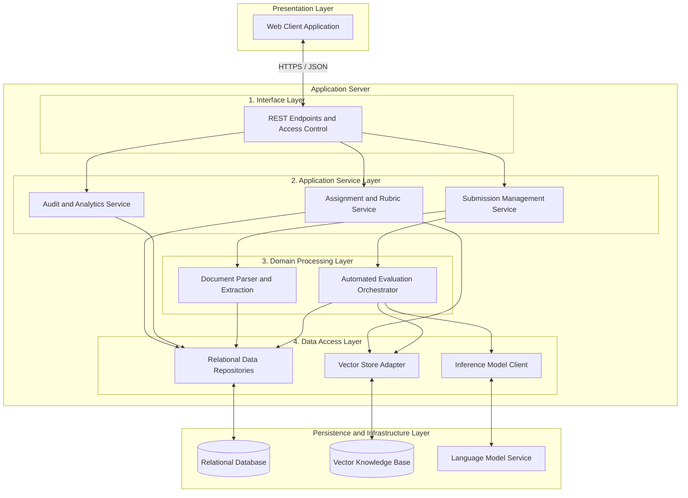
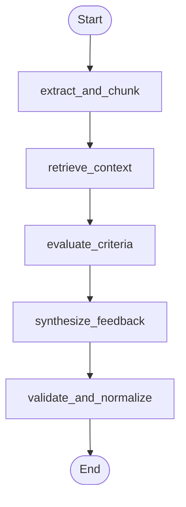

# Assess: Rubric-Based Code and Submission Evaluation Platform

Assess is an evaluation platform designed for university programming assignments and technical coursework. It assists instructors by automatically analyzing student code and documents against explicit rubric criteria, locating line-by-line evidence, and generating tentative draft evaluations that instructors review, adjust, and release.

## The Problem It Solves

Grading programming assignments and open-ended technical lab reports is one of the most time-consuming parts of teaching computer science:

1. The Grading Bottleneck: Instructors and teaching assistants spend dozens of hours manually reading code files and reports line by line. As classes grow to hundreds of students, grading backlogs cause weeks of delay before students receive their marks.

2. Inconsistent Scoring: Grading dozens of assignments over many hours leads to fatigue. The same logic error or formatting omission might be penalized heavily on one submission and missed on another, creating unfair grading differences across the class.

3. Vague Feedback: Due to time limits, students often receive little more than a final number score with short notes. Students are left guessing why points were deducted and how to improve their code structure or algorithmic logic.

4. The Risk of Unchecked AI: Using generic AI chatbots to grade student work is unreliable. Without structured guidelines, language models can produce arbitrary marks and fail to explain their reasoning. Students and teachers cannot trust an automated system that operates without human oversight.

### How Assess Solves This

Assess supports instructors rather than replacing them:

- Explicit Rubric Standards: Instructors define the exact criteria, descriptions, and point values, such as Algorithmic Correctness, Modularity, and Edge-Case Handling.
- Verifiable Line Citations: Every proposed score links directly to specific line numbers and quote excerpts in the student's submission. No grade is suggested without evidence.
- Human Control: The AI only produces tentative drafts. No grade or comment is ever visible to a student until the instructor inspects the evidence, adjusts the score if necessary, and approves the release.
- Actionable Feedback: Students receive clear reports outlining their specific strengths, areas for growth, and explanations for every rubric criterion.
- Audit Trail: Every score adjustment made by an instructor is saved with its reasoning, ensuring complete fairness and transparency.


<details>
<summary>Quick Start</summary>

### Running the Application

Run both the backend and frontend concurrently with a single command:

```bash
make dev
```

- Backend API: http://localhost:8000 (Swagger documentation: http://localhost:8000/docs)
- Frontend Application: http://localhost:5173

Press Ctrl+C to stop both servers gracefully.

### Common Commands

```bash
make setup          # Install dependencies for backend (uv) and frontend (bun)
make test           # Run both backend pytest and frontend vitest suites
make test-backend   # Run backend tests only
make test-frontend  # Run frontend tests only
make build          # Build frontend production bundle
make seed           # Seed the database with sample users and coursework
make clean          # Clean temporary cache and build artifacts
```

</details>


## Architecture Diagrams

### 1. System Architecture



### 2. Evaluation Agent Workflow Graph



<details>
<summary>Complete Requirements Coverage</summary>

### 1. Functional Requirements (FR-01 to FR-27)

| ID | Requirement Description | Status | Verification Suite |
| :--- | :--- | :---: | :--- |
| FR-01 | User authentication with secure login mechanism | Verified | test_auth_and_assignments.py, test_security_rbac_api.py |
| FR-02 | Three distinct roles: Student, Professor, and Administrator | Verified | test_models.py, test_security_and_roles.py |
| FR-03 | Strict role-based access control across data and endpoints | Verified | test_security_rbac_api.py, theme_and_layout.test.ts |
| FR-04 | Professor can create assignments with titles, instructions, and constraints | Verified | test_auth_and_assignments.py, test_professor_journey.py |
| FR-05 | Professor can create, edit, and delete rubric criteria for an assignment | Verified | test_rubric_crud_api.py, frontend_workflows.test.ts |
| FR-06 | Each rubric criterion defines name, description, max marks, and weight | Verified | test_models.py, frontend_workflows.test.ts |
| FR-07 | Student can view all assignments available to them | Verified | test_student_journey.py, AssignmentsList.tsx |
| FR-08 | Student can upload submissions in PDF or source-code formats | Verified | test_submissions_api.py, SubmitAssignment.tsx |
| FR-09 | System validates uploaded files against permitted extensions and size limits | Verified | test_submissions_api.py, frontend_workflows.test.ts |
| FR-10 | System associates each submission with its student and assignment | Verified | test_submissions_api.py, test_student_journey.py |
| FR-11 | Text and code extraction from submitted PDF and source files | Verified | test_doc_processor.py |
| FR-12 | Semantic and AST chunking with line number indexing | Verified | test_chunking.py |
| FR-13 | Rubric criteria stored in vector knowledge base with embeddings | Verified | test_vector_store_rubric_and_submission.py |
| FR-14 | Semantic similarity retrieval matching submission sections to rubric criteria | Verified | test_vector_store_rubric_and_submission.py |
| FR-15 | Controlled execution via 5-stage workflow pipeline | Verified | test_langgraph_pipeline.py |
| FR-16 | Tentative scores generated for each individual rubric criterion | Verified | test_llm_evaluator.py, test_evaluations_api.py |
| FR-17 | Structured, criterion-specific feedback generation | Verified | test_llm_evaluator.py |
| FR-18 | Feedback identifies observations, deficiencies, and improvement suggestions | Verified | test_llm_evaluator.py, StudentFeedbackView.tsx |
| FR-19 | Relational mapping between assignment, rubric, submission, scores, and feedback | Verified | test_models.py, test_evaluations_api.py |
| FR-20 | Professor can inspect generated draft evaluation with line citations | Verified | test_evaluations_api.py, ReviewEvaluation.tsx |
| FR-21 | Professor can modify marks and feedback notes before releasing | Verified | test_evaluations_api.py, test_professor_journey.py |
| FR-22 | System distinguishes tentative AI drafts from professor-approved final grades | Verified | test_evaluations_api.py, test_student_journey.py |
| FR-23 | Student can only view permitted feedback after professor approval | Verified | test_student_journey.py, test_security_rbac_api.py |
| FR-24 | Evaluation history snapshots stored for auditability and appeals | Verified | test_evaluation_history_audit.py, frontend_workflows.test.ts |
| FR-25 | Administrator can manage user accounts, assign roles, and set system config | Verified | test_admin_api.py, test_admin_journey.py |
| FR-26 | Asynchronous processing status exposed for ongoing evaluations | Verified | test_submissions_api.py, frontend_workflows.test.ts |
| FR-27 | Detection, reporting, and isolation of failures in individual evaluation stages | Verified | test_stage_failure_recovery.py |

### 2. Non-Functional Requirements (NFR-01 to NFR-22)

| ID | Category | Requirement | Status |
| :--- | :--- | :--- | :---: |
| NFR-01 | Performance | Sub-second normal UI response and fast API queries | Verified |
| NFR-02 | Performance | Asynchronous background evaluation without blocking UI | Verified |
| NFR-03 | Performance | Reduces grading turnaround time compared to manual evaluation | Verified |
| NFR-04 | Reliability | Stage failure isolation without producing invalid grades | Verified |
| NFR-05 | Reliability | Evaluations cannot be marked final solely by AI completion | Verified |
| NFR-06 | Reliability | Zero data loss on submitted files and evaluation records | Verified |
| NFR-07 | Scalability | Modular, stateless backend architecture | Verified |
| NFR-08 | Security | JWT authentication required for all protected endpoints | Verified |
| NFR-09 | Security | Strict role-based authorization for Student, Professor, and Admin | Verified |
| NFR-10 | Security | Student data isolation: students only access their own work | Verified |
| NFR-11 | Security | Professor boundary enforcement: professors only manage their courses | Verified |
| NFR-12 | Security | Server-side file extension and size validation before processing | Verified |
| NFR-13 | Security | Secret keys and LLM credentials stored strictly on backend | Verified |
| NFR-14 | Usability | Intuitive submission upload workflow for students | Verified |
| NFR-15 | Usability | Structured grading studio and rubric manager for professors | Verified |
| NFR-16 | Maintainability | Decoupled components (Extraction, Chunking, Retrieval, Evaluation, Storage) | Verified |
| NFR-17 | Consistency | Defined rubric is the primary evaluation reference for every submission | Verified |
| NFR-18 | Traceability | Every score links directly to assignment, rubric, and submission quotes | Verified |
| NFR-19 | Data Integrity | Score values bounded by criterion maximum marks | Verified |
| NFR-20 | Availability | Application remains operational when individual evaluations fail | Verified |
| NFR-21 | Extensibility | Architecture supports adding new programming languages and file formats | Verified |
| NFR-22 | Auditability | Professor adjustments saved with timestamp and reason in audit log | Verified |

### 3. AI and RAG Requirements (AI-01 to AI-08)

| ID | Requirement | Status |
| :--- | :--- | :---: |
| AI-01 | Uses assignment rubric criteria as evaluation context rather than open-ended prompt | Verified |
| AI-02 | Retrieves relevant rubric criteria using semantic similarity before scoring | Verified |
| AI-03 | Controlled workflow pipeline: processing, retrieval, evaluation, validation, synthesis | Verified |
| AI-04 | Generates criterion-wise scores rather than solely an overall grade | Verified |
| AI-05 | Generates structured feedback associated with each individual criterion | Verified |
| AI-06 | Preserves evaluation context and line citations for score traceability | Verified |
| AI-07 | AI-generated marks remain tentative drafts until approved by faculty | Verified |
| AI-08 | Computes evaluation quality metrics: MAE delta, rubric coverage, and averages | Verified |

</details>
